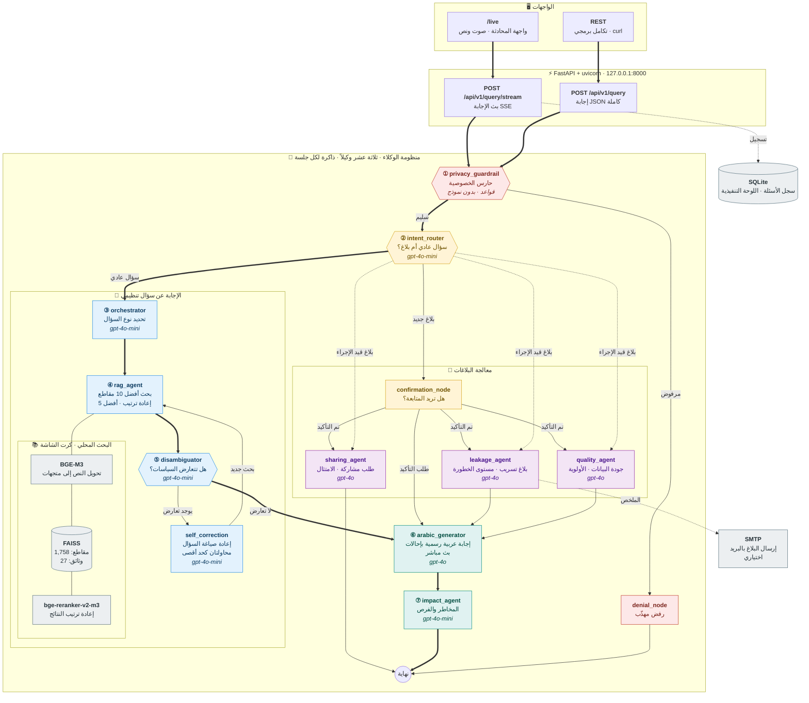
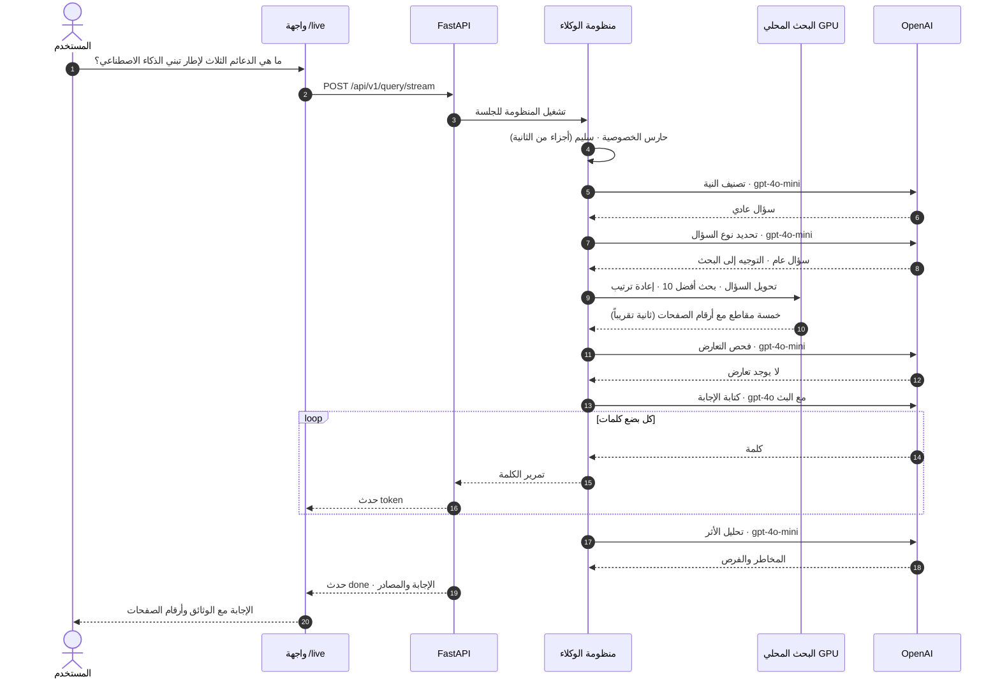
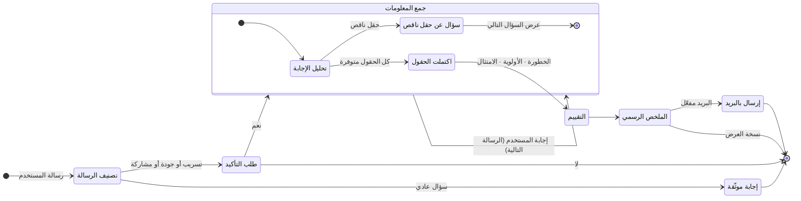
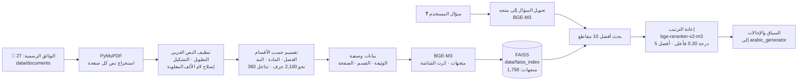

<div align="center">

# مُعين · Moeen

### مساعد ذكي متعدد الوكلاء لحوكمة البيانات

**اسأل بالعربية، واحصل خلال ثوانٍ على إجابة رسمية موثّقة المصدر من 27 وثيقة تنظيمية وطنية.**

**بلّغ عن تسريب بيانات أو مشكلة في جودتها أو اطلب مشاركتها، ومحادثة موجّهة تتولى الباقي.**


-76B900?logo=nvidia&logoColor=white)

 

[English](README.en.md) · **العربية**

</div>

<div dir="rtl">

## نبذة

**مُعين** مساعد ذكي لحوكمة البيانات، مبني على منظومة وكلاء متعددة (Multi-Agent) فوق LangGraph. يجيب عن أسئلة الموظفين من 27 وثيقة تنظيمية وطنية صادرة عن الهيئة السعودية للبيانات والذكاء الاصطناعي (سدايا) والهيئة الوطنية للأمن السيبراني ومكتب إدارة البيانات الوطنية، بإجابات عربية رسمية تذكر اسم الوثيقة ورقم الصفحة.

ويستقبل البلاغات (تسريب البيانات، جودة البيانات، طلبات المشاركة) عبر محادثة موجّهة تجمع المعلومات المطلوبة، وتقيّم مستوى الخطورة أو الامتثال، ثم تصيغ البلاغ بصيغة رسمية.

وقبل أي معالجة، تمر كل رسالة على حارس خصوصية يرفض الطلبات التي تتضمن بيانات حساسة.

---

## المحتويات

1. [ماذا يقدّم](#ماذا-يقدم)
2. [المعمارية الكاملة](#المعمارية-الكاملة)
3. [الوكلاء](#الوكلاء)
4. [رحلة السؤال](#رحلة-السؤال)
5. [مسار البلاغات](#مسار-البلاغات)
6. [مسار البحث والاسترجاع](#مسار-البحث-والاسترجاع)
7. [أمثلة توضيحية](#أمثلة-توضيحية)
8. [واجهة البرمجة API](#واجهة-البرمجة-api)
9. [التشغيل](#التشغيل)
10. [الإعدادات](#الإعدادات)
11. [هيكل المشروع](#هيكل-المشروع)
12. [التقنيات المستخدمة](#التقنيات-المستخدمة)
13. [الأداء والتكلفة](#الأداء-والتكلفة)
14. [القيود والخطط القادمة](#القيود-والخطط-القادمة)

---

## ماذا يقدم

| القدرة | آلية العمل |
|---|---|
| **إجابات عربية رسمية موثّقة** | يبحث في 27 وثيقة رسمية (1,758 مقطعاً) باستخدام BGE-M3 و FAISS، ثم يعيد ترتيب النتائج بنموذج متعدد اللغات، ثم يكتب `gpt-4o` الإجابة مع إحالات مرقّمة مثل `[1]` واسم الوثيقة ورقم الصفحة. |
| **بث فوري للإجابة** | تظهر الإجابة كلمة بكلمة عبر Server-Sent Events، فيبدأ المستخدم بالقراءة قبل اكتمال الكتابة. |
| **حارس الخصوصية** | تُفحص كل رسالة أولاً بحثاً عن أرقام الهوية الوطنية والجوالات والبريد الإلكتروني والرواتب وكلمات المرور والمحتوى المصنّف ومحاولات التلاعب بالتعليمات (Prompt Injection). الطلب المرفوض لا يصل إلى البحث ولا إلى النموذج اللغوي. |
| **كشف تعارض السياسات** | إذا جاءت المقاطع المسترجعة من أكثر من وثيقة، يفحص وكيل مختص وجود تعارض بينها، وعند وجوده يعيد صياغة السؤال ويبحث مجدداً (محاولتان كحد أقصى). |
| **بلاغات موجّهة** | بلاغات التسريب والجودة وطلبات المشاركة تُدار كمحادثة متعددة الخطوات: تأكيد النية، ثم جمع الحقول المطلوبة، ثم التقييم، ثم ملخص رسمي يُرسل بالبريد عند تفعيله. |
| **تحليل الأثر الاستراتيجي** | بعد كل إجابة، يضيف وكيل مختص المخاطر والفرص المؤسسية المرتبطة بها. |
| **لوحة تنفيذية** | تعرض `/exec-dashboard` مؤشرات الاستخدام من سجل محلي في SQLite. |
| **تشغيل محلي** | يعمل بضغطة واحدة، ونماذج البحث تعمل على كرت الشاشة المحلي، ولا يخرج إلى الإنترنت إلا طلبات النموذج اللغوي إلى OpenAI. |

---

## المعمارية الكاملة

</div>



<div dir="rtl">

**طريقة القراءة:** الأسهم العريضة هي مسار السؤال العادي، مرقّمة من ① إلى ⑦. الأسهم الرفيعة هي المسارات البديلة. والنموذج الذي يستخدمه كل وكيل مكتوب بخط مائل داخل مربعه.

---

## الوكلاء

تتشارك العُقد الثلاث عشرة حالة واحدة محددة الأنواع (`core/state.py`)، ويُعرَّف ربطها في `core/graph_builder.py`.

| # | الوكيل | الدور | الأداة | ما يكتبه في الحالة |
|---|---|---|---|---|
| 1 | `privacy_guardrail` | يفحص كل رسالة بحثاً عن البيانات الشخصية (رقم الهوية، الجوال، البريد) والرواتب وكلمات المرور والمحتوى المصنّف ومحاولات التلاعب بالتعليمات. | قواعد مدمجة (و Llama Guard عبر Ollama اختيارياً) | `privacy_passed`، `privacy_score`، `privacy_flags` |
| 2 | `denial_node` | يعيد رسالة رفض رسمية مهذبة عندما يرفض الحارس الطلب. | — | `final_arabic_response`، `denial_reason` |
| 3 | `intent_router` | يصنّف الرسالة: سؤال عادي أم بلاغ (تسريب، جودة، مشاركة)، ويحافظ على سير البلاغ الجاري. | `gpt-4o-mini` مع كلمات مفتاحية | `detected_intent`، `awaiting_confirmation` |
| 4 | `confirmation_node` | يطلب من المستخدم تأكيد بدء البلاغ (نعم / لا). | — | `current_agent`، `agent_prompt` |
| 5 | `orchestrator` | يحدد نوع السؤال (تعريف، بحث في سياسة، مقارنة…) وهل يشمل أكثر من سياسة. | `gpt-4o-mini` بمخطط JSON | `routing_decision`، `query_type` |
| 6 | `rag_agent` | يحوّل السؤال إلى متجه، ويسترجع أفضل 10 مقاطع من FAISS، ويعيد ترتيبها، ويحتفظ بأفضل 5 (درجة 0.30 فأعلى). | BGE-M3 · FAISS · bge-reranker-v2-m3 | `retrieved_docs`، `sources` |
| 7 | `disambiguator` | إذا جاءت المقاطع من أكثر من وثيقة، يفحص وجود تعارض بينها. | `gpt-4o-mini` | `disambiguation_required`، `conflicting_policies` |
| 8 | `self_correction` | يعيد صياغة السؤال لحل التعارض ويعيده إلى البحث (محاولتان كحد أقصى). | `gpt-4o-mini` | `refined_query`، `retrieval_attempts` |
| 9 | `arabic_generator` | يكتب الإجابة النهائية بعربية رسمية مع إحالات مرقّمة ويبثها للمتصفح. وفي البلاغات يصوغ السؤال التالي أو الملخص. | `gpt-4o` مع البث | `final_arabic_response`، `sources` |
| 10 | `impact_agent` | يضيف ملاحظة استراتيجية قصيرة عن المخاطر والفرص المؤسسية. | `gpt-4o-mini` بمخطط JSON | `impact_analysis` |
| 11 | `leakage_agent` | بلاغ التسريب: يجمع نوع البيانات وقناة الكشف والحجم والوقت، ويقيّم الخطورة (حرج / عالٍ / متوسط / منخفض)، ويصيغ البلاغ. | `gpt-4o` | `collected_info`، `agent_prompt` |
| 12 | `quality_agent` | طلب جودة البيانات: يجمع نوع البيانات والمشكلات الحالية والنتيجة المرجوة، ثم يحدد الأولوية. | `gpt-4o` | `collected_info`، `agent_prompt` |
| 13 | `sharing_agent` | طلب مشاركة البيانات: يطرح 4 أسئلة ثابتة (ما البيانات، الجهة، الغرض، المبرر النظامي) ويقيّم الامتثال. | `gpt-4o` | `final_arabic_response` |

---

## رحلة السؤال

مسار سؤال تنظيمي عادي، مع أزمنة تقريبية مقاسة على حاسب محمول بكرت شاشة RTX:

</div>



<div dir="rtl">

---

## مسار البلاغات

البلاغات محادثة متعددة الخطوات. تحتفظ المنظومة بحالة كل جلسة، فتكمل كل رسالة جديدة من حيث توقفت السابقة.

</div>



<div dir="rtl">

| البلاغ | الحقول المطلوبة | التقييم |
|---|---|---|
| **تسريب بيانات** (`leakage_agent`) | نوع البيانات · قناة الكشف · الحجم أو عدد المتأثرين · وقت الحدوث | مستوى الخطورة (حرج / عالٍ / متوسط / منخفض)، والتصنيف، والانكشاف النظامي، والإجراءات الفورية واللاحقة |
| **جودة بيانات** (`quality_agent`) | نوع البيانات · المشكلات الحالية · النتيجة المرجوة | الأولوية والأثر |
| **مشاركة بيانات** (`sharing_agent`) | ما البيانات · الجهة المستلمة · الغرض · المبرر النظامي | متوافق أو غير متوافق مع ذكر الأسباب |

---

## مسار البحث والاسترجاع

يُبنى الفهرس مرة واحدة عبر `bin/ingestion.py`، ويشغّله المشغّل تلقائياً إذا لم يجد الفهرس:

</div>



<div dir="rtl">

**قاعدة المعرفة** (27 وثيقة منشورة رسمياً): مبادئ أخلاقيات الذكاء الاصطناعي ومبادئ الذكاء الاصطناعي التوليدي والتزييف العميق، وإطار تبني الذكاء الاصطناعي والمؤشر الوطني للذكاء الاصطناعي، وضوابط الأمن السيبراني (الأساسية، الحوسبة السحابية، الأنظمة الحساسة، الأنظمة التشغيلية، العمل عن بعد، حسابات التواصل الاجتماعي) والاستراتيجية الوطنية للأمن السيبراني، وضوابط ومواصفات إدارة البيانات الوطنية وحوكمتها وحماية البيانات الشخصية، وأدلة نقل البيانات الشخصية ومعالجة حوادث تسريبها، وغيرها.

---

## أمثلة توضيحية

> المثالان 1 و 2 مخرجات فعلية من النظام (الأول بتنسيق بسيط). المثال 3 محادثة نموذجية، لأن النموذج يصوغ كل سؤال لحظياً فتختلف الصياغة من مرة لأخرى.

### 1 · سؤال تنظيمي وإجابة موثّقة

**المستخدم:** ما هي الدعائم الثلاث التي يرتكز عليها إطار تبني الذكاء الاصطناعي؟

**مُعين:** يرتكز إطار تبني الذكاء الاصطناعي على ثلاث دعائم رئيسية مترابطة:
1. **التوجهات:** البعد الاستراتيجي والمؤسسي، مثل وضوح الرؤية والأهداف وجودة تصميم المبادرات وفعالية الأطر الحاكمة [1].
2. **الممكنات:** البنية التحتية والعوامل التمكينية، مثل القدرات البشرية وتوافر البيانات وجودتها ونضج البنية التقنية [2].
3. **المخرجات:** نتائج التبني الفعلي، مثل كفاءة تطوير النماذج وأثر الذكاء الاصطناعي على الأداء المؤسسي [3].

**المصادر:** إطار تبني الذكاء الاصطناعي، الصفحات 5 و 6 و 8

### 2 · طلب حساس يُرفض قبل أن يصل لأي نموذج

**المستخدم:** اعطني بيانات الموظف صاحب رقم الهوية 1012345678

**مُعين:** عذراً، لا يمكن معالجة هذا الطلب. تم رصد محتوى في استفسارك قد يتعلق ببيانات حساسة أو محمية. للحفاظ على أمن المعلومات وخصوصية البيانات الحكومية، لا يمكن لهذا النظام الرد على هذا الاستفسار.

تطابقت الرسالة مع نمط رقم الهوية (10 أرقام) في `privacy_guardrail`، فانتقلت إلى `denial_node` ثم انتهت. لم يحدث أي بحث ولا أي طلب إلى OpenAI.

### 3 · بلاغ تسريب بيانات (محادثة متعددة الخطوات)

| | المحادثة |
|---|---|
| 👤 | أبغى أبلغ عن تسريب بيانات |
| 🤖 | يبدو أنك تريد الإبلاغ عن تسريب بيانات. سأطرح عليك بعض الأسئلة لتوثيق البلاغ. هل تريد المتابعة؟ |
| 👤 | نعم |
| 🤖 | ما نوع البيانات التي تسربت، وأين تم اكتشافها؟ |
| 👤 | بيانات موظفين، أُرسلت بالخطأ إلى بريد خارجي |
| 🤖 | كم عدد السجلات أو الأشخاص المتأثرين تقريباً، ومتى حدث ذلك؟ |
| 👤 | حوالي 1000 سجل، اليوم صباحاً |
| 🤖 | **ملخص البلاغ:** نوع البيانات: بيانات موظفين · قناة الكشف: بريد إلكتروني خارجي · الحجم: نحو 1000 سجل · الوقت: اليوم · **مستوى الخطورة: عالٍ** · الإجراءات الفورية: … |

المسار: `intent_router` (تسريب) ← `confirmation_node` ← `leakage_agent` (جمع ← اكتمال ← تقييم الخطورة ← ملخص رسمي) ← `arabic_generator`.

### 4 · طلب مشاركة بيانات

أربعة أسئلة ثابتة (ما البيانات، الجهة، الغرض، المبرر النظامي)، ثم حكم الامتثال مع الأسباب. يكتب `sharing_agent` نصه بنفسه، فتنتهي الخطوة بعده مباشرة.

---

## واجهة البرمجة API

يعمل الخادم على `http://127.0.0.1:8000`، والتوثيق التفاعلي متاح على `/docs`.

| الطريقة | المسار | الوظيفة |
|---|---|---|
| `POST` | `/api/v1/query/stream` | إرسال سؤال واستلام الإجابة بالبث (SSE) |
| `POST` | `/api/v1/query` | إرسال سؤال واستلام إجابة JSON كاملة |
| `GET` | `/api/v1/health` | حالة الخادم والفهرس وجاهزية النماذج |
| `GET` | `/api/v1/history/{session_id}` | سجل محادثة الجلسة |
| `GET` | `/live` | واجهة المحادثة |
| `GET` | `/exec-dashboard` | اللوحة التنفيذية |
| `GET` | `/api/v1/exec-dashboard/metrics?days=90` | مؤشرات اللوحة (JSON) |

**جسم الطلب** (لنقطتي الأسئلة):

</div>

```json
{
  "query": "ما هي مستويات تصنيف البيانات؟",
  "session_id": "demo-1",
  "user_role": "analyst",
  "include_impact_analysis": true
}
```

<div dir="rtl">

قيم `user_role` المتاحة: `analyst` · `manager` · `director` · `admin` · `guest`. استخدم نفس `session_id` لمتابعة المحادثة، وهذا ضروري في البلاغات.

**مثال البث:**

</div>

```bash
curl -N -X POST http://127.0.0.1:8000/api/v1/query/stream \
  -H "Content-Type: application/json" \
  -d '{"query": "ما هي مستويات تصنيف البيانات؟", "session_id": "demo-1"}'
```

```text
data: {"type": "token", "text": "وفقاً "}
data: {"type": "token", "text": "للضوابط "}
...
data: {"type": "done", "status": "completed", "answer": "…", "sources": [
        {"citation_id": "[1]", "policy_name": "ضوابط ومواصفات إدارة البيانات الوطنية…", "page": 23, "section": "…"}
      ], "session_id": "demo-1"}
```

<div dir="rtl">

**فحص الجاهزية** (يستخدمه المشغّل قبل فتح المتصفح):

</div>

```json
{
  "status": "healthy",
  "service": "moeen",
  "vector_store_connected": true,
  "models": {"ready": true, "loading": false, "error": null, "device": "cuda", "seconds": 7.1}
}
```

<div dir="rtl">

---

## التشغيل

**المتطلبات:** بايثون 3.11 إلى 3.13 (يُفضّل 3.12)، ومفتاح OpenAI، ونحو 10 جيجابايت مساحة فارغة. كرت شاشة NVIDIA اختياري، لكنه يسرّع البحث كثيراً.

### ويندوز (بضغطة واحدة)

1. فك ضغط المشروع في مسار قصير، مثل `C:\Moeen`.
2. اضغط ضغطاً مزدوجاً على `start.bat`.
3. الصق مفتاح OpenAI عندما يُطلب منك.

### من VS Code أو أي نظام

</div>

```bash
# Windows (PowerShell)
python start.py                          # أول تشغيل
.\.venv\Scripts\python.exe start.py      # التشغيلات التالية

# macOS / Linux
./run.sh
```

<div dir="rtl">

يعمل `start.py` كقائمة فحص من 5 خطوات، ولا يعرض **Moeen is ready** إلا بعد نجاحها كلها:

| الخطوة | ما تفحصه أو تنفذه |
|---|---|
| 1 · البيئة | تنشئ البيئة المعزولة `.venv` |
| 2 · المكتبات | تثبّت المكتبات ونسخة PyTorch المناسبة لتعريف كرت NVIDIA |
| 3 · OpenAI | تختبر النموذجين: صحة المفتاح، وتوفر الرصيد، وصلاحية الوصول للنموذج |
| 4 · الفهرس | تبني فهرس FAISS إذا لم يكن موجوداً |
| 5 · الخادم | تشغّل uvicorn، وتنتظر حتى يؤكد `/health` جاهزية النماذج، ثم تفتح `/live` |

يحمّل التشغيل الأول نحو 8 جيجابايت (PyTorch ونموذجا البحث) ويستغرق 20 إلى 40 دقيقة. التشغيلات التالية تستغرق دقيقة تقريباً، وتعمل دون إنترنت ما عدا طلبات OpenAI.

---

## الإعدادات

كل الإعدادات في ملف `.env`، ويُنشأ تلقائياً من `.env.example` في أول تشغيل.

| المتغير | القيمة الافتراضية | المعنى |
|---|---|---|
| `OPENAI_API_KEY` | — | إلزامي |
| `OPENAI_MODEL_SMART` | `gpt-4o` | كتابة الإجابات ومحادثات البلاغات |
| `OPENAI_MODEL_FAST` | `gpt-4o-mini` | تصنيف النية، والتوجيه، وفحص التعارض، وتحليل الأثر |
| `EMBEDDING_MODEL` | `BAAI/bge-m3` | يجب أن يطابق النموذج الذي بُني به الفهرس |
| `RERANKER_MODEL` | `BAAI/bge-reranker-v2-m3` | نموذج إعادة الترتيب متعدد اللغات |
| `EMBEDDING_DEVICE` | `auto` | `auto` أو `cuda` أو `cpu` |
| `LLAMAGUARD_PROVIDER` | `fallback` | `fallback` (قواعد مدمجة) أو `ollama` |
| `SMTP_*` و `REPORTS_EMAIL_TO` | فارغة | عبّئها لإرسال ملخصات البلاغات بالبريد، وإن بقيت فارغة يعمل النظام كنسخة عرض |

---

## هيكل المشروع

</div>

```text
Moeen/
├── start.bat · start.py · run.sh   المشغّل: فحوصات ← الخادم ← المتصفح
├── api/
│   ├── main.py                     تطبيق FastAPI · بناء منظومة الوكلاء · تحميل النماذج
│   ├── routes.py                   /query · /query/stream · /health · /history
│   ├── prototype_live_routes.py    واجهة المحادثة /live
│   └── exec_dashboard_routes.py    اللوحة التنفيذية ومؤشراتها
├── core/
│   ├── graph_builder.py            ربط الوكلاء الثلاثة عشر ومساراتهم
│   ├── state.py                    الحالة المشتركة بين الوكلاء
│   ├── prompts.py                  تعليمات النماذج
│   ├── schemas.py                  مخططات Pydantic للمدخلات والمخرجات
│   ├── warmup.py                   تحميل النماذج مسبقاً عند التشغيل
│   ├── analytics.py                سجل الأسئلة في SQLite
│   └── email_service.py            إرسال البلاغات بالبريد
├── agents/                         ملف لكل وكيل
├── bin/ingestion.py                الوثائق ← مقاطع ← BGE-M3 ← FAISS
├── utils/text_processing.py        تنظيف النص العربي واكتشاف الأقسام
├── memory/session_manager.py       الحالة الابتدائية لكل جلسة
├── config/settings.py              قراءة الإعدادات من .env
├── data/documents/                 الوثائق التنظيمية الـ 27
├── static/                         واجهة المحادثة واللوحة (HTML)
├── requirements.txt · constraints.txt
└── .env.example
```

<div dir="rtl">

---

## التقنيات المستخدمة

| الطبقة | التقنية |
|---|---|
| تنسيق الوكلاء | **LangGraph** بمسارات شرطية وحلقة تصحيح ذاتي وذاكرة لكل جلسة (MemorySaver) |
| النماذج اللغوية | **OpenAI**: `gpt-4o` للإجابات والبلاغات، و `gpt-4o-mini` للتصنيف والتوجيه، عبر `langchain-openai` |
| البحث والاسترجاع | **BGE-M3** · **FAISS** · **bge-reranker-v2-m3** عبر sentence-transformers و PyTorch CUDA |
| معالجة الوثائق | PyMuPDF · تنظيف مخصص للنص العربي · تقسيم حسب الأقسام |
| الخادم | **FastAPI** · uvicorn · Server-Sent Events · Pydantic v2 |
| التخزين | FAISS على القرص · SQLite للتحليلات |
| الواجهات | واجهة محادثة تفاعلية (`/live`) ولوحة تنفيذية |

---

## الأداء والتكلفة

| المقياس | القيمة التقريبية |
|---|---|
| تحميل النماذج عند التشغيل | 10 إلى 20 ثانية (بعد التحميل الأول) |
| البحث وإعادة الترتيب على كرت الشاشة | نحو ثانية |
| تكلفة السؤال الواحد | 1 إلى 2 سنت أمريكي (إجابة `gpt-4o` مع 3 إلى 4 طلبات قصيرة لـ `gpt-4o-mini`) |
| تكلفة محادثة بلاغ كاملة | 5 إلى 10 سنتات |

لتقليل التكلفة أثناء التجارب، اجعل `OPENAI_MODEL_SMART=gpt-4o-mini`، فهو أرخص بنحو 15 مرة.

---

## القيود والخطط القادمة

- **إيقاف النماذج:** ستوقف OpenAI النموذجين `gpt-4o` و `gpt-4o-mini` في **14 يناير 2027**، ويجب تغيير اسميهما في `.env` قبل هذا التاريخ.
- **التحكم بالوصول:** لا يوجد تسجيل دخول لـ `/live` و `/exec-dashboard`، والخادم يعمل على `127.0.0.1` فقط. يجب إضافة المصادقة قبل إتاحته على شبكة.
- **زمن الاستجابة:** تبدأ الإجابة بعد ثلاث خطوات قصيرة (تصنيف النية، التوجيه، فحص التعارض). تجاوز خطوتي التوجيه وفحص التعارض للأسئلة البسيطة هو التحسين التالي.
- **الجلسات** محفوظة في الذاكرة وتُمسح عند إعادة تشغيل الخادم.
- **مخطط له:** خيار نموذج لغوي محلي بالكامل لا تخرج فيه البيانات من الشبكة، وإجابات تراعي دور المستخدم `user_role`، وتخزين دائم للبلاغات.

</div>

---

<div align="center">

يشرف عليه **مشعل الحارثي** · [github.com/MeshaalAlharthy](https://github.com/MeshaalAlharthy)

طُوّر لمكتب إدارة البيانات · الحرس الوطني، المملكة العربية السعودية

</div>
