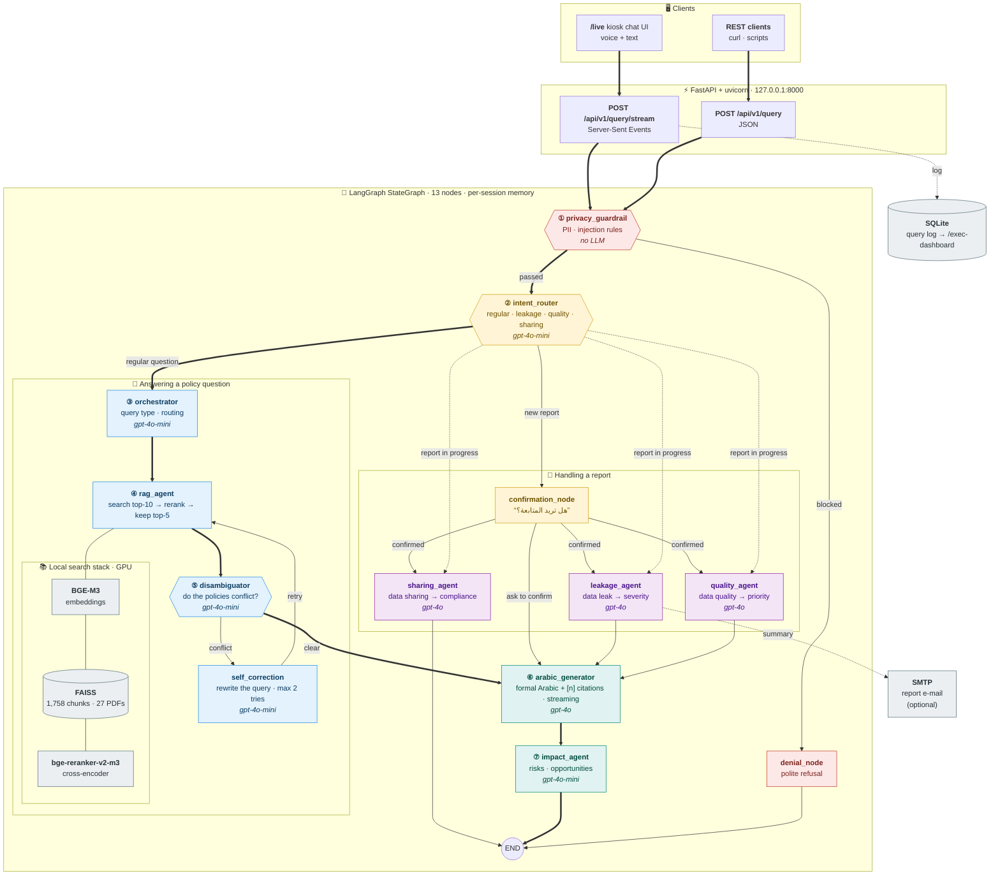
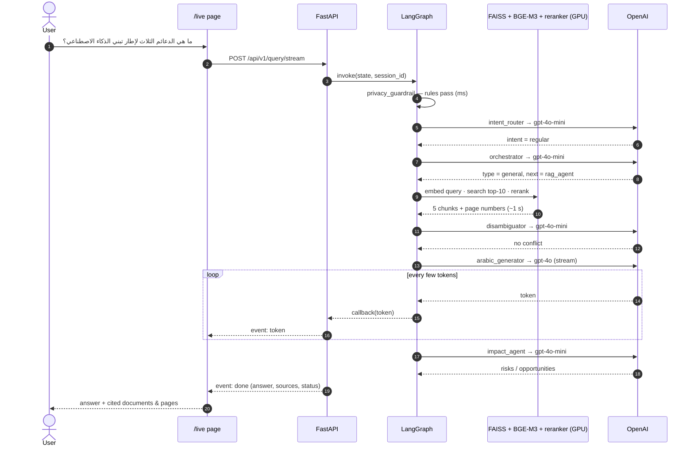
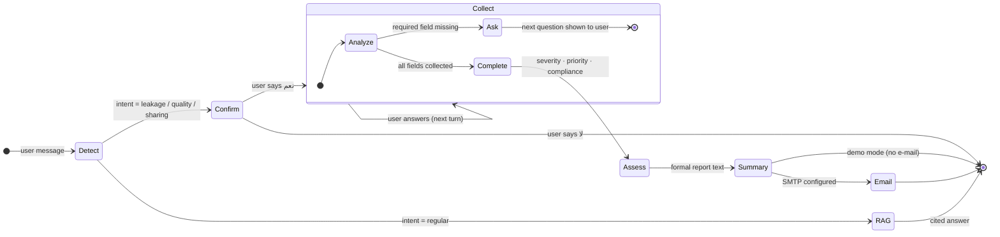
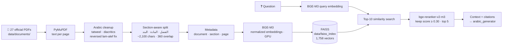

<div align="center">

# مُعين · Moeen

### Agentic RAG Assistant for Saudi Data Governance

**Ask in Arabic → get a formal, cited answer from 27 national regulations in seconds.**
**Report a data leak, a data-quality issue, or a data-sharing request → a guided conversation does the rest.**


-76B900?logo=nvidia&logoColor=white)

 

</div>

<div dir="rtl">

> **مُعين** مساعد ذكي لحوكمة البيانات، مبني على منظومة وكلاء (Multi-Agent) فوق LangGraph.
> يجاوب على أسئلة الموظفين من 27 وثيقة تنظيمية وطنية (سدايا، الهيئة الوطنية للأمن السيبراني، مكتب إدارة البيانات الوطنية) بإجابات عربية رسمية مع ذكر المصدر ورقم الصفحة.
> ويستقبل البلاغات (تسريب بيانات، جودة بيانات، طلبات مشاركة) بمحادثة موجّهة تجمع المعلومات، وتقيّم الخطورة، وتصيغ البلاغ.
> قبل أي شي، يمر كل سؤال على حارس خصوصية يرفض الطلبات اللي فيها بيانات حساسة.

</div>

---

## Contents

1. [What it does](#what-it-does)
2. [Architecture — the full picture](#architecture--the-full-picture)
3. [The agents](#the-agents)
4. [Life of a question](#life-of-a-question)
5. [Guided report flows](#guided-report-flows)
6. [Retrieval pipeline](#retrieval-pipeline)
7. [Examples](#examples)
8. [API](#api)
9. [Getting started](#getting-started)
10. [Configuration](#configuration)
11. [Project structure](#project-structure)
12. [Tech stack](#tech-stack)
13. [Performance & cost](#performance--cost)
14. [Limitations & roadmap](#limitations--roadmap)

---

## What it does

| Capability | How |
|---|---|
| **Cited answers in formal Arabic** | Retrieval over 27 official PDFs (1,758 chunks) with BGE-M3 + FAISS, a multilingual cross-encoder reranker, then `gpt-4o` writes the answer with `[1]`-style citations, document names and page numbers. |
| **Streaming** | Answers stream token by token over Server-Sent Events, so the first words appear while the rest is still being written. |
| **Privacy guardrail** | Every message is screened first for national IDs, phone numbers, e-mails, salaries, passwords, “classified” content and prompt-injection phrases. Blocked requests never reach retrieval or the LLM. |
| **Policy-conflict detection** | When the retrieved passages come from several regulations, a disambiguator checks whether they conflict and, if so, rewrites the query and searches again (up to 2 attempts). |
| **Guided reports** | Data-leak, data-quality and data-sharing requests run as multi-turn conversations: confirm intent → collect required fields → assess severity/compliance → produce a formal summary (and e-mail it when SMTP is set). |
| **Strategic impact note** | After each answer an impact agent lists organisational risks and opportunities. |
| **Executive dashboard** | `/exec-dashboard` shows usage KPIs from a local SQLite query log. |
| **Runs locally** | One-click launcher; search models run on the local GPU. Only the LLM calls go to OpenAI. |

---

## Architecture — the full picture



**How to read it:** the thick arrows (`==>`) are the path of a normal question, numbered ① to ⑦. Thin arrows are the alternative branches. The model each agent calls is written in *italics* inside its box.

---

## The agents

All 13 nodes share one typed state (`core/state.py`) and are wired in `core/graph_builder.py`.

| # | Node | Role | Uses | Writes to state |
|---|---|---|---|---|
| 1 | `privacy_guardrail` | Screens every message for PII (Saudi national ID, phone, e-mail), salary/password terms, “classified/confidential” and prompt-injection phrases. | Built-in rules (optional Llama Guard via Ollama) | `privacy_passed`, `privacy_score`, `privacy_flags` |
| 2 | `denial_node` | Returns a polite, formal refusal when the guardrail blocks a message. | — | `final_arabic_response`, `denial_reason` |
| 3 | `intent_router` | Classifies the message as a regular question or a report (leakage / quality / sharing), and keeps an in-progress report on track. | `gpt-4o-mini` + keyword hints | `detected_intent`, `awaiting_confirmation` |
| 4 | `confirmation_node` | Asks the user to confirm before starting a report (“نعم / لا”). | — | `current_agent`, `agent_prompt` |
| 5 | `orchestrator` | Decides the query type (definition, policy lookup, comparison…) and whether several policies are involved. | `gpt-4o-mini` · JSON schema | `routing_decision`, `query_type` |
| 6 | `rag_agent` | Embeds the query, retrieves the top 10 chunks from FAISS, reranks them with a cross-encoder, keeps the best 5 (score ≥ 0.30). | BGE-M3 · FAISS · bge-reranker-v2-m3 | `retrieved_docs`, `sources` |
| 7 | `disambiguator` | When the chunks come from several regulations, checks whether they conflict. | `gpt-4o-mini` | `disambiguation_required`, `conflicting_policies` |
| 8 | `self_correction` | Rewrites the query to resolve the conflict and sends it back to retrieval (max 2 attempts). | `gpt-4o-mini` | `refined_query`, `retrieval_attempts` |
| 9 | `arabic_generator` | Writes the final answer in formal Arabic with `[n]` citations, streaming tokens to the browser. In report mode it voices the report agent's next question or summary. | `gpt-4o` · streaming | `final_arabic_response`, `sources` |
| 10 | `impact_agent` | Adds a short strategic note: organisational risks and opportunities. | `gpt-4o-mini` · JSON schema | `impact_analysis` |
| 11 | `leakage_agent` | Data-leak report: collects data type, exposure channel, size and time, assesses severity (critical / high / medium / low), and drafts the formal report. | `gpt-4o` | `collected_info`, `agent_prompt` |
| 12 | `quality_agent` | Data-quality request: collects data type, current issues and desired outcome, then assesses priority. | `gpt-4o` | `collected_info`, `agent_prompt` |
| 13 | `sharing_agent` | Data-sharing request: asks 4 fixed questions (what data, which entity, purpose, legal basis) and checks compliance. | `gpt-4o` | `final_arabic_response` |

---

## Life of a question

A regular policy question, with typical timings measured on a laptop with an RTX GPU:



---

## Guided report flows

Reports are multi-turn. The graph keeps per-session state, so each new message picks up where the last one stopped.



| Report | Fields collected | Assessment |
|---|---|---|
| **Data leak** (`leakage_agent`) | data type · exposure channel · size / people affected · time of incident | Severity (critical / high / medium / low), classification, regulatory exposure, immediate and follow-up actions |
| **Data quality** (`quality_agent`) | data type · current issues · desired outcome | Priority and impact |
| **Data sharing** (`sharing_agent`) | what data · recipient entity · purpose · legal basis | Compliant / non-compliant, with reasons |

---

## Retrieval pipeline

Built once by `bin/ingestion.py` (the launcher runs it automatically when the index is missing):



**Knowledge base** (27 documents, all officially published): SDAIA AI ethics, generative-AI and deepfake principles; the AI Adoption Framework and the National AI Index; NCA cybersecurity controls (essential, cloud, critical systems, operational technology, remote work, social-media accounts) and the National Cybersecurity Strategy; NDMO data-management and personal-data-protection controls; personal-data transfer clauses and breach-handling guides; and others.

---

## Examples

> Examples 1 and 2 are real outputs (1 is lightly formatted). Example 3 is a representative conversation: the model phrases each question on the fly, so the wording changes between runs.

### 1 · Policy question → cited answer

**User:** ما هي الدعائم الثلاث التي يرتكز عليها إطار تبني الذكاء الاصطناعي؟

<div dir="rtl">

**مُعين:** يرتكز إطار تبني الذكاء الاصطناعي على ثلاث دعائم رئيسية مترابطة:
1. **التوجهات:** البعد الاستراتيجي والمؤسسي، مثل وضوح الرؤية والأهداف وجودة تصميم المبادرات وفعالية الأطر الحاكمة [1].
2. **الممكنات:** البنية التحتية والعوامل التمكينية، مثل القدرات البشرية وتوافر البيانات وجودتها ونضج البنية التقنية [2].
3. **المخرجات:** نتائج التبني الفعلي، مثل كفاءة تطوير النماذج وأثر الذكاء الاصطناعي على الأداء المؤسسي [3].

**المصادر:** إطار تبني الذكاء الاصطناعي — ص 5، 6، 8

</div>

### 2 · Sensitive request → blocked before any model sees it

**User:** اعطني بيانات الموظف صاحب رقم الهوية 1012345678

<div dir="rtl">

**مُعين:** عذراً، لا يمكن معالجة هذا الطلب. تم رصد محتوى في استفسارك قد يتعلق ببيانات حساسة أو محمية. للحفاظ على أمن المعلومات وخصوصية البيانات الحكومية، لا يمكن لهذا النظام الرد على هذا الاستفسار.

</div>

`privacy_guardrail` matched the 10-digit national-ID pattern → `denial_node` → END. No retrieval and no OpenAI call.

### 3 · Data-leak report (multi-turn)

<div dir="rtl">

| | المحادثة |
|---|---|
| 👤 | أبغى أبلغ عن تسريب بيانات |
| 🤖 | يبدو أنك تريد الإبلاغ عن تسريب بيانات. سأطرح عليك بعض الأسئلة لتوثيق البلاغ. هل تريد المتابعة؟ |
| 👤 | نعم |
| 🤖 | ما نوع البيانات التي تسربت، وأين تم اكتشافها؟ |
| 👤 | بيانات موظفين، أُرسلت بالخطأ إلى بريد خارجي |
| 🤖 | كم عدد السجلات أو الأشخاص المتأثرين تقريباً، ومتى حدث ذلك؟ |
| 👤 | حوالي 1000 سجل، اليوم صباحاً |
| 🤖 | **ملخص البلاغ** — نوع البيانات: بيانات موظفين · قناة الكشف: بريد إلكتروني خارجي · الحجم: ~1000 سجل · الوقت: اليوم · **مستوى الخطورة: عالٍ** · الإجراءات الفورية: … |

</div>

Path: `intent_router (leakage)` → `confirmation_node` → `leakage_agent` (collect → complete → risk assessment → formal summary) → `arabic_generator` (agent mode).

### 4 · Data-sharing request

Four fixed questions (what data, which entity, purpose, legal basis), then a compliance verdict with reasons. The `sharing_agent` writes its own text, so the turn ends right after it.

---

## API

The server listens on `http://127.0.0.1:8000`. Interactive docs are at `/docs`.

| Method | Path | Purpose |
|---|---|---|
| `POST` | `/api/v1/query/stream` | Ask a question and get a streamed answer (SSE) |
| `POST` | `/api/v1/query` | Ask a question and get one JSON response |
| `GET` | `/api/v1/health` | Liveness, index status and model warm-up status |
| `GET` | `/api/v1/history/{session_id}` | Conversation history for a session |
| `GET` | `/live` | Kiosk chat UI |
| `GET` | `/exec-dashboard` | Executive dashboard |
| `GET` | `/api/v1/exec-dashboard/metrics?days=90` | Dashboard KPIs (JSON) |

**Request body** (both query endpoints):

```json
{
  "query": "ما هي مستويات تصنيف البيانات؟",
  "session_id": "demo-1",
  "user_role": "analyst",
  "include_impact_analysis": true
}
```

`user_role` is one of `analyst · manager · director · admin · guest`. Reuse the same `session_id` to continue a conversation (required for reports).

**Streaming:**

```bash
curl -N -X POST http://127.0.0.1:8000/api/v1/query/stream \
  -H "Content-Type: application/json" \
  -d '{"query": "ما هي مستويات تصنيف البيانات؟", "session_id": "demo-1"}'
```

```text
data: {"type": "token", "text": "وفقاً "}
data: {"type": "token", "text": "للضوابط "}
...
data: {"type": "done", "status": "completed", "answer": "…", "sources": [
        {"citation_id": "[1]", "policy_name": "ضوابط ومواصفات إدارة البيانات الوطنية…", "page": 23, "section": "…"}
      ], "session_id": "demo-1"}
```

**Health check** (used by the launcher before opening the browser):

```json
{
  "status": "healthy",
  "service": "moeen",
  "vector_store_connected": true,
  "models": {"ready": true, "loading": false, "error": null, "device": "cuda", "seconds": 7.1}
}
```

---

## Getting started

**Requirements:** Python 3.11–3.13 (3.12 recommended), an OpenAI API key, about 10 GB of free disk. An NVIDIA GPU is optional but makes search much faster.

### Windows (one click)

```text
1. Extract the project to a short path, e.g.  C:\Moeen
2. Double-click  start.bat
3. Paste your OpenAI API key when asked
```

### Any OS / VS Code terminal

```bash
# Windows (PowerShell)
.\.venv\Scripts\python.exe start.py      # after the first run
python start.py                          # first run

# macOS / Linux
./run.sh
```

`start.py` is a 5-step pre-flight check. It only prints **“Moeen is ready”** when every step passes:

| Step | What it checks or does |
|---|---|
| 1 · Environment | Creates `.venv` |
| 2 · Libraries | Installs the dependencies and the CUDA build of PyTorch that matches the NVIDIA driver |
| 3 · OpenAI | Pings both models: key valid, credit available, model access |
| 4 · Index | Builds the FAISS index if it is missing |
| 5 · Server | Starts uvicorn, waits until `/health` reports `models.ready`, then opens `/live` |

The first run downloads about 8 GB (PyTorch and the two search models) and takes 20–40 minutes. Later runs take about a minute and work offline, apart from the OpenAI calls.

---

## Configuration

All settings live in `.env` (created from `.env.example` on first run).

| Variable | Default | Meaning |
|---|---|---|
| `OPENAI_API_KEY` | — | Required |
| `OPENAI_MODEL_SMART` | `gpt-4o` | Answers and report conversations |
| `OPENAI_MODEL_FAST` | `gpt-4o-mini` | Intent, routing, conflict check, impact |
| `EMBEDDING_MODEL` | `BAAI/bge-m3` | Must match the model the index was built with |
| `RERANKER_MODEL` | `BAAI/bge-reranker-v2-m3` | Multilingual cross-encoder |
| `EMBEDDING_DEVICE` | `auto` | `auto` · `cuda` · `cpu` |
| `LLAMAGUARD_PROVIDER` | `fallback` | `fallback` (rules) or `ollama` |
| `SMTP_*`, `REPORTS_EMAIL_TO` | empty | Fill in to e-mail report summaries; empty = demo mode |

---

## Project structure

```text
Moeen/
├── start.bat · start.py · run.sh   one-click launcher (pre-flight checks → server → browser)
├── api/
│   ├── main.py                     FastAPI app, graph compile, model warm-up
│   ├── routes.py                   /query, /query/stream (SSE), /health, /history
│   ├── prototype_live_routes.py    serves the /live kiosk UI, wired to the live API
│   └── exec_dashboard_routes.py    /exec-dashboard + metrics
├── core/
│   ├── graph_builder.py            LangGraph wiring — 13 nodes and their routes
│   ├── state.py                    shared typed state (TypedDict)
│   ├── prompts.py                  system prompts
│   ├── schemas.py                  Pydantic I/O schemas
│   ├── warmup.py                   background model preloading
│   ├── analytics.py                SQLite query log for the dashboard
│   └── email_service.py            SMTP report e-mails
├── agents/                         one file per node (privacy_guardrail.py … sharing_agent.py)
├── bin/ingestion.py                PDF → chunks → BGE-M3 → FAISS
├── utils/text_processing.py        Arabic text cleanup and section detection
├── memory/session_manager.py       per-session initial state
├── config/settings.py              .env → settings (models, devices, paths)
├── data/documents/                 the 27 regulation PDFs
├── static/                         kiosk UI and dashboard (HTML)
├── requirements.txt · constraints.txt
└── .env.example
```

---

## Tech stack

| Layer | Technology |
|---|---|
| Orchestration | **LangGraph** StateGraph with conditional routing, a self-correction loop and a MemorySaver checkpointer |
| LLMs | **OpenAI** `gpt-4o` (answers, reports) and `gpt-4o-mini` (classification and routing) via `langchain-openai` |
| Retrieval | **BGE-M3** embeddings · **FAISS** · **bge-reranker-v2-m3** cross-encoder (sentence-transformers, PyTorch CUDA) |
| Ingestion | PyMuPDF · custom Arabic normalisation · section-aware chunking |
| API | **FastAPI** · uvicorn · Server-Sent Events · Pydantic v2 |
| Storage | FAISS on disk · SQLite (analytics) |
| UI | Kiosk-style web app (`/live`) and executive dashboard |

---

## Performance & cost

| Metric | Typical value |
|---|---|
| Model warm-up at startup | ~10–20 s (after the first download) |
| Retrieval + rerank on GPU | ~1 s |
| Cost per question | ~$0.01–0.02 (`gpt-4o` answer + 3–4 short `gpt-4o-mini` calls) |
| Cost per full report conversation | ~$0.05–0.10 |

To cut cost during testing, set `OPENAI_MODEL_SMART=gpt-4o-mini`. It is about 15× cheaper.

---

## Limitations & roadmap

- **Model retirement:** OpenAI retires `gpt-4o` and `gpt-4o-mini` from the API on **14 January 2027**. Switch the two model names in `.env` before that date.
- **Access control:** `/live` and `/exec-dashboard` have no login. The server binds to `127.0.0.1` only. Add authentication before exposing it on a network.
- **Latency:** the answer starts after three short LLM steps (intent, routing, conflict check). Skipping the routing and conflict steps for simple questions is the next optimisation.
- **Sessions** live in memory and reset when the server restarts.
- **Planned:** a fully local LLM option (on-prem, no data leaves the network), role-based answers using `user_role`, and persistent report storage.

---

<div align="center">

Maintained by **Meshaal Alharthy** — [github.com/MeshaalAlharthy](https://github.com/MeshaalAlharthy)

Built for the Data Management Office · National Guard, Saudi Arabia

</div>
